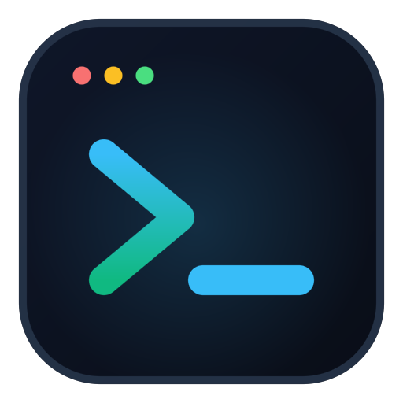
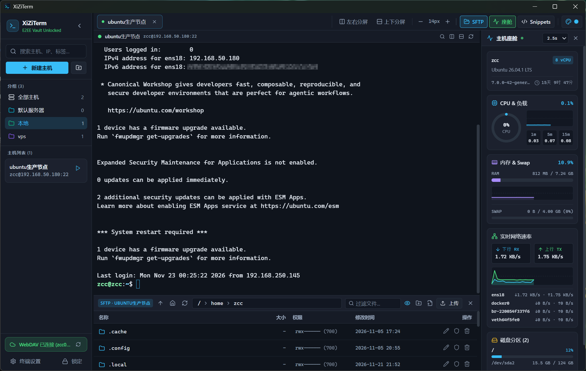
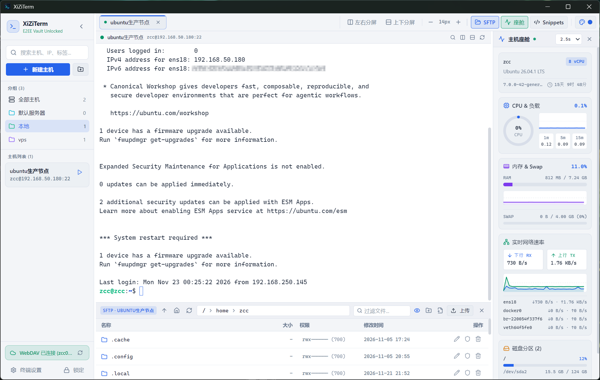
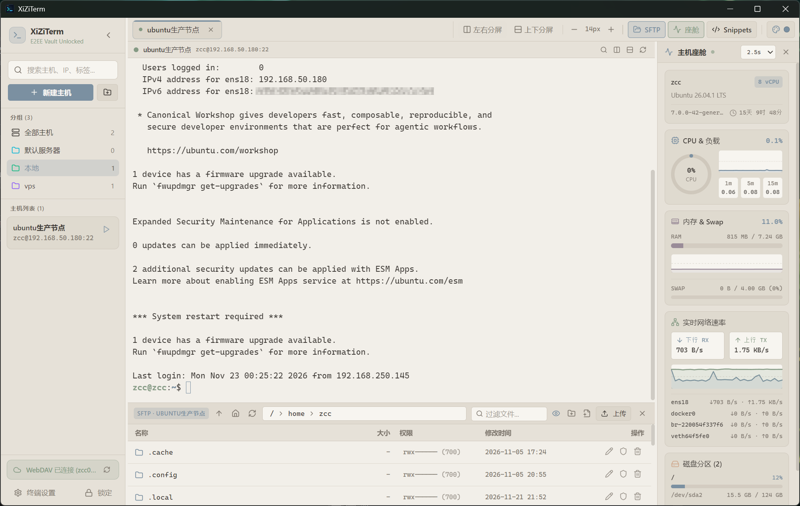
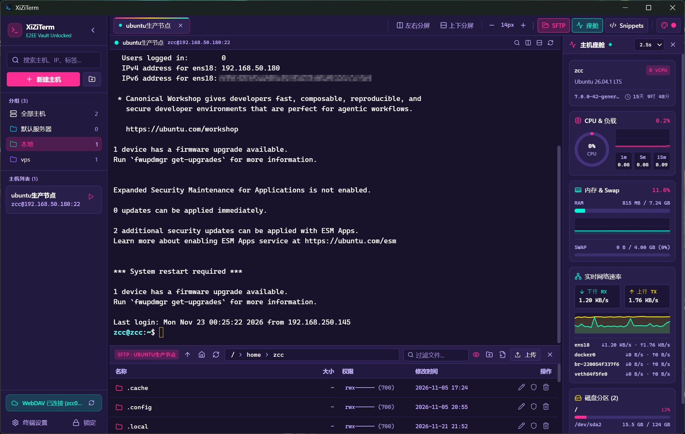
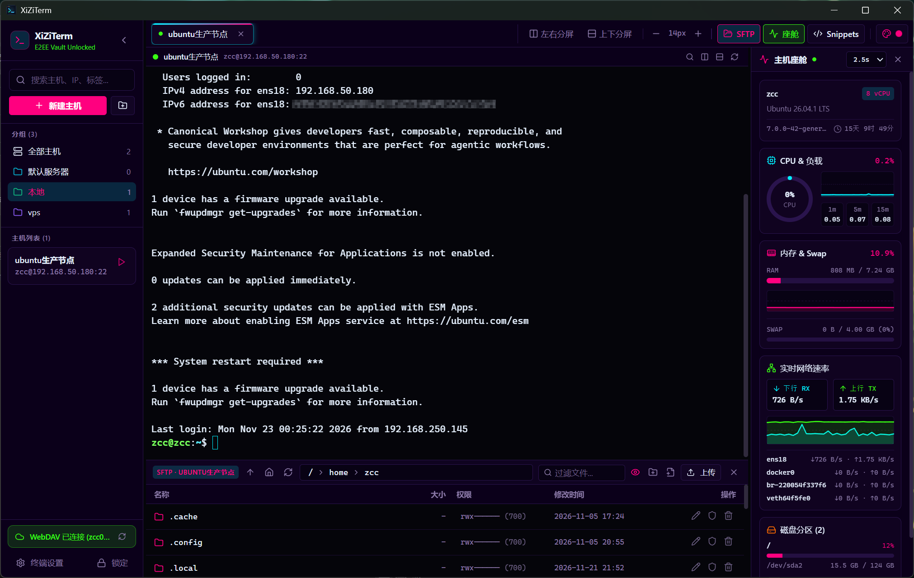
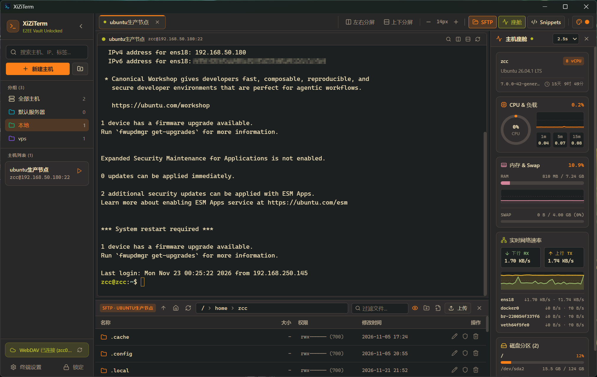
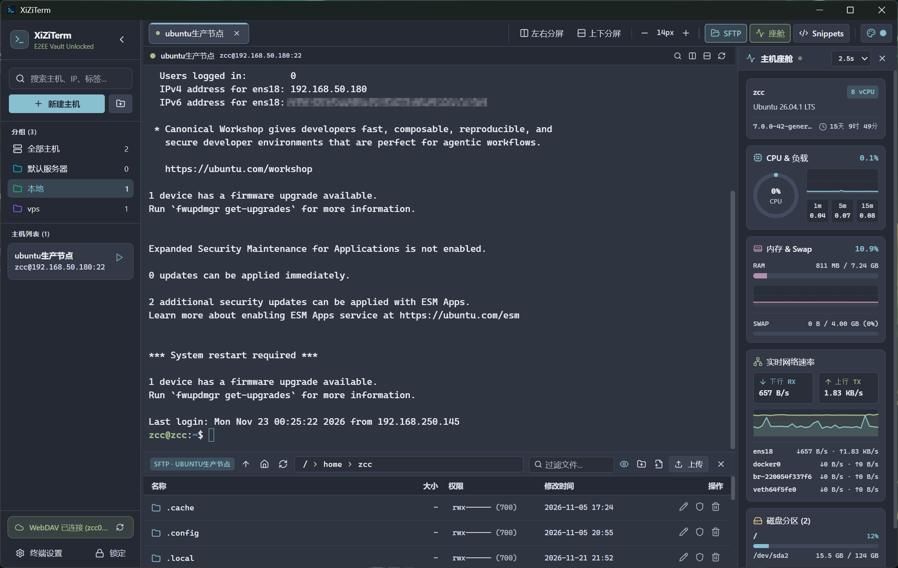

<div align="center">
  
  <h1>XiZiTerm</h1>
  <p><strong>自托管、端到端零知识加密的现代化跨平台 SSH 终端与 SFTP 管理工具</strong></p>
  <p>
    <a href="https://github.com/zcc0030/XiZiTerm/actions/workflows/ci.yml"></a>
    <a href="https://github.com/zcc0030/XiZiTerm/releases"></a>
    <a href="LICENSE"></a>
  </p>
</div>

<p align="center">
  
</p>

---

## 项目简介

**XiZiTerm** 是一款注重数据主权与操作体验的跨平台 SSH 终端客户端（支持 **Windows / macOS / Linux**）。所有主机凭据、SSH 私钥、快捷命令与偏好设置均在本地通过主密码派生密钥进行 **`AES-256-GCM` 端到端零知识加密（E2EE）**，支持通过 **WebDAV 网盘 / NAS**（免建站）或 **Docker 自托管同步服务端** 在多台设备间安全同步。

### 核心功能

- **多标签与自由分屏终端**：基于 `xterm.js` + `ssh2`，支持密码 / 私钥（含 Passphrase）认证、多级分组与标签筛选、同一标签页内任意左右/上下递归分屏、终端内搜索与断线一键重连。
- **内置可视化 SFTP 文件管理**：直接复用当前 SSH 连接通道，支持面包屑路径跳转、本地文件/文件夹拖拽上传、传输进度展示、`chmod` 八进制/九宫格权限修改，以及远程配置文件在线编辑（`Ctrl+S` 直存）。
- **无 Agent 实时主机座舱**：无需在目标服务器安装任何监控 Agent，连接后自动通过只读系统接口实时采集并绘制 CPU 仪表盘、系统负载、内存/Swap、网卡上下行速率折线图与磁盘分区占用。
- **快捷命令库（Snippets）**：支持单行命令与多行运维脚本分类管理，提供「仅输入不回车（便于改参）」与「输入并立即执行」双模式一键下发。
- **双模零知识云同步（E2EE）**：
  - **免服务器 WebDAV 同步**：原生支持坚果云、飞牛 fnOS、群晖 Synology、Nextcloud、Alist / OpenList 等标准 WebDAV 服务，自动检测 NAS 共享目录权限并通过 ETag 乐观锁防并发冲突。
  - **自托管 VPS 同步服务端**：内置轻量级 `Fastify + SQLite` Docker 服务端，客户端内提供完整部署指南与 SSH 一键自动部署工具（含端口占用检测，不干扰原服务）。
- **7 套内置主题配色（UI 与终端完全同步）**：内置 **正常日间 (`light`)**、**现代夜间 (`dark`)**、**多巴胺撞色 (`dopamine`)**、**莫兰迪灰调 (`morandi`)**、**赛博朋克 (`cyberpunk`)**、**复古怀旧 (`retro` / Gruvbox)**、**北欧冰川 (`nordic` / Nord)**，切换时应用面板、监控折线图与所有已打开终端的 16 色 ANSI 调色板实时同步。

---

## 界面与内置主题一览

> 上方主图为默认的 **现代夜间 (`dark`)** 主题，以下为其余 6 套内置同步主题实拍（点击图片可查看原尺寸高清大图）：

<table>
  <tr>
    <td align="center" width="50%">
      <br />
      <sub><b>正常日间 (Light)</b> — 清爽高对比度办公护眼</sub>
    </td>
    <td align="center" width="50%">
      <br />
      <sub><b>莫兰迪灰调 (Morandi)</b> — 暖燕麦白与雾霾蓝纸质阅读感</sub>
    </td>
  </tr>
  <tr>
    <td align="center" width="50%">
      <br />
      <sub><b>多巴胺撞色 (Dopamine)</b> — 紫罗兰底搭配粉/薄荷绿/柠檬黄活力折线</sub>
    </td>
    <td align="center" width="50%">
      <br />
      <sub><b>赛博朋克 (Cyberpunk)</b> — 极暗纯黑底 + 电光蓝与霓虹粉双主色辉光</sub>
    </td>
  </tr>
  <tr>
    <td align="center" width="50%">
      <br />
      <sub><b>复古怀旧 (Retro / Gruvbox)</b> — 经典暖泥土色调与微圆角 CRT 质感</sub>
    </td>
    <td align="center" width="50%">
      <br />
      <sub><b>北欧冰川 (Nordic / Nord)</b> — Nord 冷灰暗蓝基调与极光绿</sub>
    </td>
  </tr>
</table>

---

## 安装包下载

前往 [**GitHub Releases**](https://github.com/zcc0030/XiZiTerm/releases) 页面即可下载最新预编译安装包：

| 平台 | 安装包类型 |
| :--- | :--- |
| **Windows (x64)** | `XiZiTerm-Setup-x.y.z.exe`（安装版） / `XiZiTerm-Portable-x.y.z.exe`（单文件便携版） / **Scoop 命令行安装** |
| **macOS (Apple Silicon / Intel)** | `XiZiTerm-x.y.z-arm64.dmg` / `XiZiTerm-x.y.z-x64.dmg` |
| **Linux (x64)** | `XiZiTerm-x.y.z-x86_64.AppImage` / `XiZiTerm-x.y.z-amd64.deb` |

### Windows 使用 Scoop 一键安装 / 升级 / 卸载

```powershell
# 1. 添加软件源（仅首次需要）
scoop bucket add zcc0030 https://github.com/zcc0030/scoop-bucket

# 2. 安装 XiZiTerm（自动创建开始菜单快捷方式与命令行入口）
scoop install xiziterm

# 3. 后续升级与卸载
scoop update; scoop update xiziterm
scoop uninstall xiziterm
```

> **macOS 提示**：开源构建未附加付费 Apple 开发者签名，首次打开如提示「无法验证开发者」，可在终端执行 `sudo xattr -rd com.apple.quarantine /Applications/XiZiTerm.app` 后正常启动。

---

## 源码本地开发与构建

环境要求：**Node.js >= 22.5**（服务端使用内置 `node:sqlite`）。

```bash
# 1. 安装工作区依赖
npm install

# 2. 全量 TypeScript 类型检查（shared + desktop + server）
npm run typecheck

# 3. 启动桌面客户端（开发热重载模式）
npm run dev

# 4. 本地启动自托管同步服务端（默认监听 http://127.0.0.1:8787）
npm run dev:server

# 5. 构建桌面安装包（输出至 apps/desktop/release/）
npm run dist:win    # Windows
npm run dist:mac    # macOS
npm run dist:linux  # Linux
```

---

## 云同步配置指南

### 方式一：WebDAV 网盘 / NAS 同步（推荐，零运维）

无需购买 VPS：打开客户端左下角 **「配置云同步」** → 选择 **「WebDAV 网盘」**：
- **坚果云**：在「账户信息 → 安全选项 → 第三方应用管理」生成应用专用密码，填入即可自动创建 `/XiZiTerm/xiziterm-vault.enc.json` 密文包。
- **飞牛 fnOS / 群晖 NAS**：填入 NAS WebDAV 地址与账号密码后点击「测试 WebDAV 连通性」，客户端会自动列出可用共享目录供一键点选（如 `/共享目录名/XiZiTerm`）。

### 方式二：Docker 自建同步服务端（VPS）

服务端仅存储 `AES-256-GCM` 密文信封与序列号，无法解密任何明文凭据。你既可以使用客户端内置向导一键部署，也可以在 VPS 上手动执行：

```bash
cp apps/server/.env.example .env
# 按需修改 XIZITERM_PORT（默认 8787）或设置注册邀请码 INVITE_CODE
vim .env

# 构建并后台启动容器
docker compose up -d --build

# 健康检查
curl http://127.0.0.1:8787/api/health
```

**生产环境安全建议**：
1. 使用 Caddy 或 Nginx 为同步端口配置 HTTPS 反向代理。
2. 完成个人账号注册后，将 `.env` 中的 `ALLOW_REGISTRATION=false` 并执行 `docker compose up -d` 关闭公开注册。
3. 定期备份 `apps/server/data/xiziterm.db` 单文件即可完成全量密文备份。

---

## 安全架构说明

- **密钥派生**：`PBKDF2-HMAC-SHA512`（`600,000` 次迭代 + `256-bit` 随机盐），主密码永不落盘、永不上传。
- **数据加密**：每条记录独立随机 `96-bit` IV，采用 `AES-256-GCM` 认证加密并绑定记录类型/ID/版本作为 `AAD`（附加认证数据），防止密文替换或篡改。
- **进程隔离**：渲染进程开启 `contextIsolation: true`、`nodeIntegration: false`；SSH 连接、SFTP 传输与保险库加解密全部在 Electron 主进程内完成。

---

## 开源协议

本项目基于 [MIT License](LICENSE) 开源。
